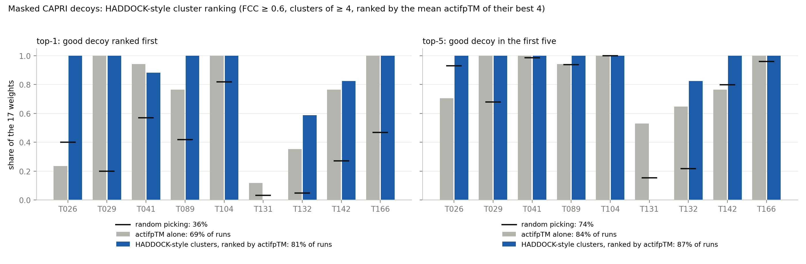
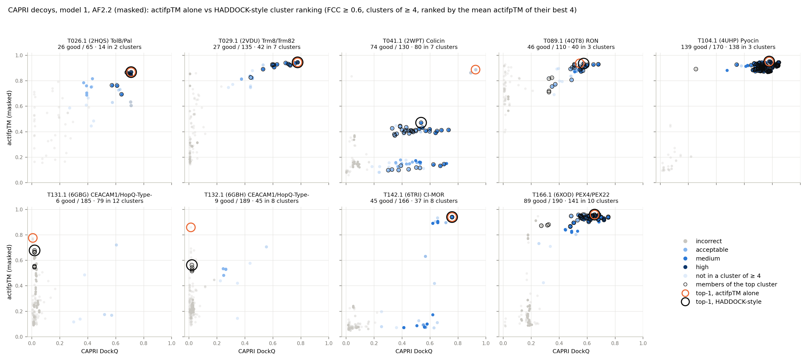
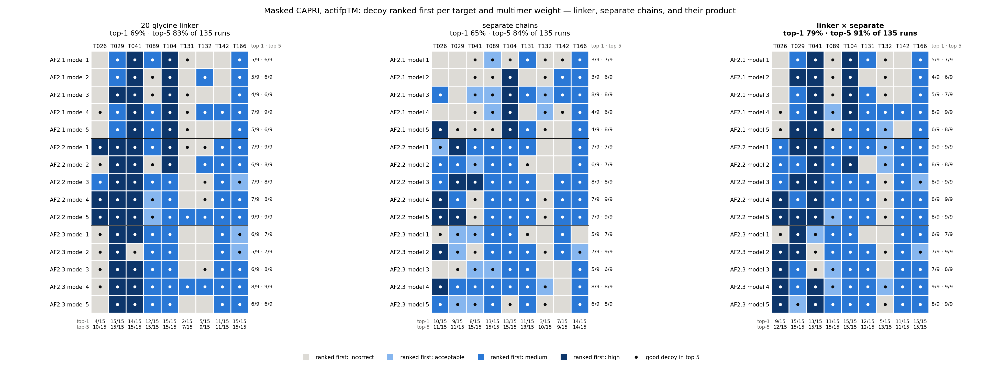
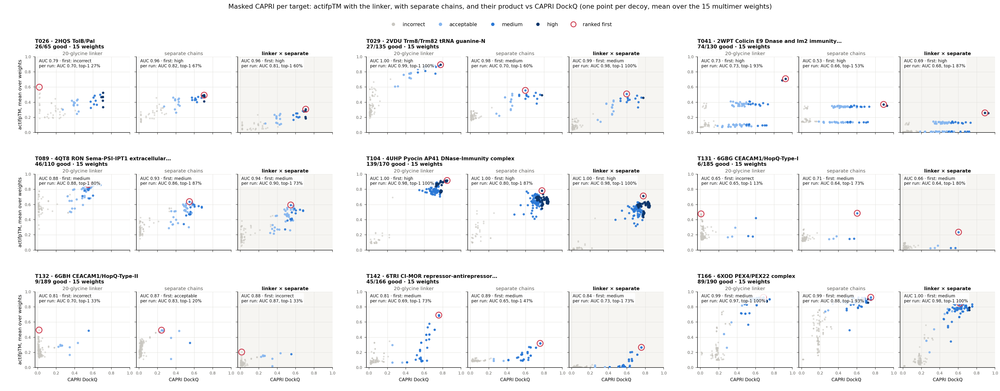
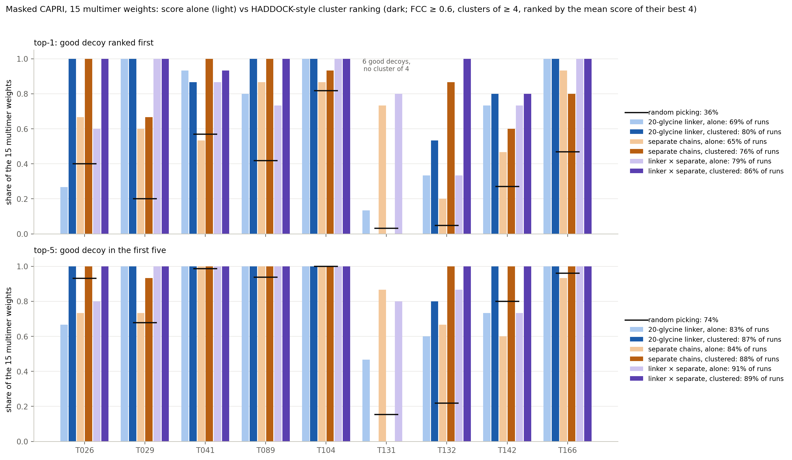
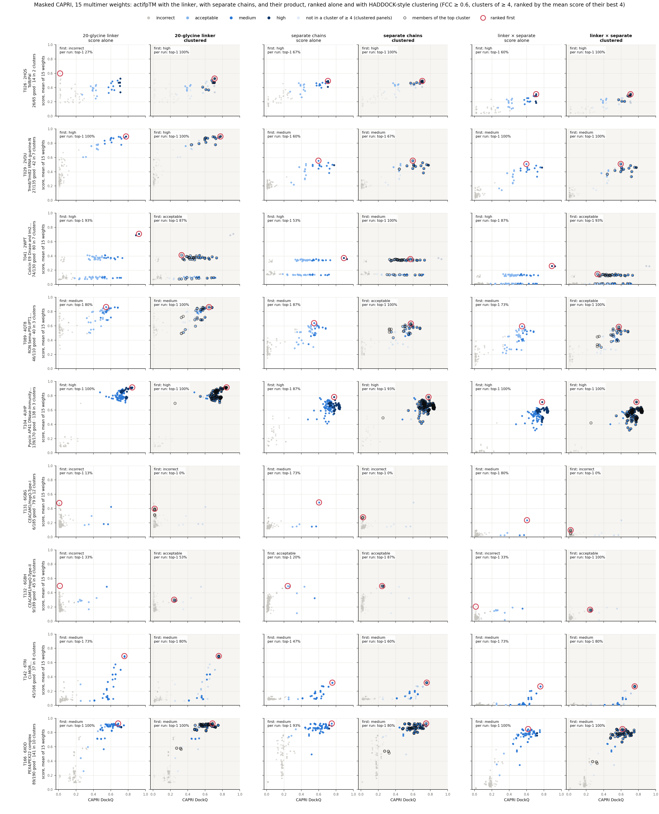

# CAPRI decoy benchmark

Can AF2Rank tell good docking models from bad ones? We scored the CAPRI Score_set decoys of 9 two-chain protein–protein targets with all 17 AlphaFold2 weights and compared each score with CAPRI's own DockQ and quality classes. Settings and scores are defined in the [main README](../../README.md#scores-and-settings).

Three sets of runs, one run = one target scored with one weight:
- **full resolution:** template sequence and side chains visible, 0 recycles; 153 runs;
- **masked,** the AF2Rank paper's setting: sequence and side chains masked, 1 recycle; 153 runs. Multimer weights get the two chains joined by a 20-glycine linker (the pipeline default);
- **masked, separate chains:** the same, but multimer weights get the two chains as separate templates (`--multimer-linker 0`), as in the original af2rank-pipeline; 135 runs (the 15 multimer weights).

**Result.**
- **Masked, AlphaFold's interface confidence separates good from incorrect decoys.** actifpTM ranks a good decoy first in 69% of runs (random picking: 36%), with median AUC 0.83. At full resolution AlphaFold copies the decoys, and the same scores are close to random (top-1 44%).
- **Combining the models of one AlphaFold version helps.** Averaging each decoy's rank over the AF2.2 or AF2-ptm models puts a good decoy first for 7 of 9 targets and within the top 5 for all 9.
- **Clustering the decoys first, as HADDOCK does, helps further:** ranking interface clusters by their best members' actifpTM puts a good decoy first in 81% of runs.
- **For multimer weights, the linker and separate chains fail on different targets, and multiplying the two actifpTM values ranks best:** a good decoy first in 79% of runs, 86% with clustering. For a shortlist, the 4 best clusters plus the top decoy by this product contain a good decoy in 98% of runs ([below](#multimer-input-20-glycine-linker-vs-separate-chains)).

**This is a best case.** Every target predates the AlphaFold2 training cutoff, so AlphaFold may have seen these complexes, and the best strategies were chosen on these 9 targets. CASP15 multimer models (post-cutoff) are the planned follow-up.

## Contents

1. [Data](#data)
2. [Full resolution vs masked: which score separates good from bad decoys?](#full-resolution-vs-masked-which-score-separates-good-from-bad-decoys)
3. [Masked: by AlphaFold version](#masked-by-alphafold-version)
4. [Clustering the decoys (HADDOCK-style)](#clustering-the-decoys-haddock-style)
5. [Multimer input: 20-glycine linker vs separate chains](#multimer-input-20-glycine-linker-vs-separate-chains)
6. [Which ranking to use](#which-ranking-to-use)
7. [Reproduce](#reproduce) and [Files](#files)

## Data

Decoys come from the CAPRI scoreset v2022 ([scoreset.org](https://scoreset.org); Lensink, Mauri, Brysbaert and Wodak), Scorer (S) model sets, i.e. the decoys submitted by the CAPRI scorer groups. Targets were chosen with the rules of our NMR and X-ray benchmarks:
- two-chain protein–protein complexes of natural proteins;
- no peptide partners, designed binders or nanobodies; one entry per complex;
- at least about 15 acceptable-or-better models;
- no biological non-protein molecules in the PDB entry. This excluded T025, T032, T040, T046, T047 and T105; crystallisation additives were tolerated.

| Target | PDB | Complex | Decoys | Acceptable or better |
| --- | --- | --- | --- | --- |
| T026.1 | 2HQS | TolB/Pal | 65 | 26 |
| T029.1 | 2VDU | Trm8/Trm82 | 135 | 27 |
| T041.1 | 2WPT | colicin E9 DNase/Im2 | 130 | 74 |
| T089.1 | 4QT8 | RON Sema-PSI-IPT1 domains | 110 | 46 |
| T104.1 | 4UHP | pyocin AP41 DNase/immunity | 170 | 139 |
| T131.1 | 6GBG | CEACAM1/HopQ type I | 185 | 6 |
| T132.1 | 6GBH | CEACAM1/HopQ type II | 189 | 9 |
| T142.1 | 6TRI | CI/MOR repressor–antirepressor | 166 | 45 |
| T166.1 | 6XOD | PEX4/PEX22 | 190 | 89 |

Decoys were trimmed to the residues resolved in the native, and 10 T029 decoys covering less than half of the receptor were dropped. 1,340 decoys pass the pipeline's strict cleaning: 77 high, 244 medium, 140 acceptable and 879 incorrect. "Good" below means CAPRI acceptable or better (34%).

Eleven decoys (10 of T041, 1 of T131) have no interface in the input. All are CAPRI-incorrect, so the analysis gives them DockQ input→output 0 and the maximum PAE.

**Measures used throughout.** AUC: how well a score separates good from incorrect decoys within a run (median over runs). Top-1 and top-5: share of runs with a good decoy ranked first, or within the first five. Random picking gives 36% and 74%; top-5 says little on its own here, because most targets have many good decoys. *One ranking per target*: the score (or rank) averaged over a set of weights, then ranked once per target; reported as targets out of 9.

## Full resolution vs masked: which score separates good from bad decoys?

Good in top 10 = mean number of good decoys in the first ten. Composite = z(−PAE at input contacts) + z(actifpTM) + z(fnat input→output), with z-scores taken within each target and weight.

| Score | AUC, full → masked | Top-1, full → masked | Top-5, full → masked | Good in top 10, full → masked |
| --- | --- | --- | --- | --- |
| actifpTM | 0.67 → 0.83 | 44% → **69%** | 67% → 84% | 5.0 → **6.9** |
| PAE at input contacts | 0.75 → 0.84 | 43% → 67% | 59% → 80% | 4.9 → 6.3 |
| composite | 0.75 → **0.86** | 59% → **69%** | 73% → **86%** | 5.3 → 6.5 |
| ipTM | 0.63 → 0.82 | 39% → 61% | 57% → 79% | 4.2 → 6.2 |
| pLDDT × pTM × DockQ input→output (AF2Rank) | 0.62 → 0.81 | 54% → 67% | 65% → 82% | 4.3 → 6.1 |
| DockQ input→output | 0.60 → 0.78 | 48% → 48% | 63% → 77% | 4.0 → 5.3 |
| random picking | 0.50 | 36% | 74% | 3.6 |

Masking improves every score; masked, actifpTM alone is as good as the composite, so the rest of this page uses actifpTM.

Scores computed at full resolution only: actifpTM × fnat input→output (AUC 0.71, the best top-1 at full resolution, 64%), pTM (0.68), min inter-chain PAE (0.67), LIS and ipSAE (0.64), pDockQ (0.54).

### Full resolution: AlphaFold copies the decoy

Median DockQ input→output by CAPRI class, full resolution → masked:

| CAPRI class | AF2-ptm | AF2.1 | AF2.2 | AF2.3 |
| --- | --- | --- | --- | --- |
| incorrect | 0.85 → 0.46 | 0.82 → **0.02** | 0.70 → 0.27 | 0.79 → 0.20 |
| acceptable | 0.86 → 0.58 | 0.87 → **0.13** | 0.72 → 0.44 | 0.81 → 0.40 |
| medium | 0.86 → 0.53 | 0.78 → 0.48 | 0.68 → 0.53 | 0.78 → 0.54 |
| high | 0.89 → 0.61 | 0.88 → 0.59 | 0.72 → 0.63 | 0.84 → 0.64 |

At full resolution DockQ input→output stays above 0.6 for most incorrect decoys: 96–97% with AF2-ptm and 74–89% with AF2.3 (all 879 incorrect decoys, including the 11 without an interface). Median ipTM barely differs between incorrect and good decoys. That is why ipTM, and the paper's "kept" term (DockQ or TM-score input→output), separate poorly at full resolution; the paper masked the sequence and side chains for exactly this reason. Masked, AlphaFold lets wrong interfaces drift away while good ones mostly stay. AF2.1 also pulls apart most acceptable decoys, as it does with native X-ray interfaces ([X-ray benchmark](../xray#scores-in-the-af2rank-papers-masked-setting)).

At full resolution the composite is the best score: AUC 0.75, top-1 59%, top-5 73%. Rank-averaged over all 17 weights it reaches AUC 0.78 and ranks a good decoy first for 6 of 9 targets (7 of 9 with the AF2.2 weights alone). What did not help: ipSAE, LIS or pDockQ in place of PAE at contacts; hard gates on DockQ or iRMSD input→output; and a logistic regression on all scores trained on the other targets (median AUC 0.71). T131 and T132 (CEACAM1/HopQ, CAPRI's two "difficult" targets, with 6 and 9 good decoys) and T142 (CI/MOR) defeat every score at full resolution.


**actifpTM against CAPRI DockQ at full resolution**, model 1 of each family; one point per decoy, coloured by CAPRI class. Most decoys sit at actifpTM 0.9–1.0 whatever their quality. The same plot with ipTM is [`figures/fullres_i_ptm_vs_dockq.png`](figures/fullres_i_ptm_vs_dockq.png). [`figures/fullres_ranking_summary.png`](figures/fullres_ranking_summary.png) has three heatmaps per score (ipTM, actifpTM, PAE at input contacts), one cell per target × weight: Spearman ρ with CAPRI DockQ, AUC, and good decoys in the top 10 with the random expectation in brackets.

## Masked: by AlphaFold version

| Version | actifpTM AUC | actifpTM top-1 | actifpTM top-5 | composite AUC | composite top-1 |
| --- | --- | --- | --- | --- | --- |
| AF2-ptm (2 models) | 0.71 → 0.85 | 39% → 67% | 61% → **94%** | 0.74 → 0.88 | 50% → 61% |
| AF2.1 multimer | 0.66 → 0.79 | 31% → 58% | 62% → 73% | 0.74 → 0.77 | 44% → 62% |
| AF2.2 multimer | 0.70 → **0.88** | 58% → **80%** | 76% → 93% | 0.77 → **0.90** | 67% → **78%** |
| AF2.3 multimer | 0.64 → 0.81 | 44% → 69% | 64% → 82% | 0.76 → 0.80 | 69% → 71% |

Values are full resolution → masked, per run (AF2-ptm: 18 runs; each multimer version: 45). Every version gains from masking. AF2.2 gains most; AF2.1 and AF2.3 gain less, mostly because the composite's "kept" term (fnat input→output) also drops for good decoys.

**One ranking per target** (each decoy's rank averaged over a set of weights; targets out of 9; random picking: 3.2 first, 6.7 in the top 5):

| Weights | Score | Good decoy first, full → masked | In top 5, full → masked | Median AUC, full → masked |
| --- | --- | --- | --- | --- |
| AF2-ptm models 1–2 | composite | 5 → **8** | 7 → **9** | 0.74 → 0.89 |
| AF2-ptm models 1–2 | actifpTM | 4 → 7 | 6 → **9** | 0.75 → 0.82 |
| AF2.2 models 1–5 | actifpTM | 4 → 7 | 7 → **9** | 0.69 → 0.88 |
| AF2.2 models 1–5 | composite | 7 → 7 | 7 → 8 | 0.77 → **0.90** |
| AF2.3 models 1–5 | composite | 6 → 7 | 7 → 8 | 0.75 → 0.74 |
| AF2.1 models 1–5 | actifpTM | 3 → 5 | 5 → 6 | 0.63 → 0.76 |
| all 17 weights | actifpTM | 4 → 5 | 7 → 8 | 0.68 → 0.86 |
| all 17 weights | composite | 6 → 7 | 6 → **9** | 0.78 → 0.78 |

Pooling all 17 weights is worse than AF2-ptm or AF2.2 alone, because AF2.1 and AF2.3 add noise. The choice of version was made on these 9 targets and needs confirming on new ones (CASP15).

Per target (actifpTM, median AUC per version; [`results/masked_vs_fullres_per_target.csv`](results/masked_vs_fullres_per_target.csv)), masking raises the AUC on most targets. T104 was already near perfect (0.96–0.99). Exceptions:
- **T041** gets worse with every version (about 0.80–0.87 → 0.68–0.77). Many of its acceptable decoys (DockQ 0.3–0.5) lose confidence along with the incorrect ones, so masked AlphaFold is strict about partly right interfaces.
- **T026** drops with AF2.1 (0.66 → 0.34), where every decoy, good or not, ends at low confidence.
- **T131** stays weak with AF2.2 (0.37 → 0.52), while the other versions separate it (0.71–0.80).
- **T132** stays weak with AF2.1 (0.40 → 0.46).
- **T142** stays near random with AF2-ptm and AF2.1 (about 0.51); AF2.2 and AF2.3 reach 0.71–0.74.


**actifpTM against CAPRI DockQ, full resolution (top) and masked (bottom)**, AF2-ptm model 1, the paper's weight; one column per target, one point per decoy coloured by CAPRI class, with Spearman ρ and AUC in each panel. Masked, the incorrect decoys (grey) drop while the good ones stay confident. T131 and T132 become separable (AUC 0.81 and 0.92); with this weight AlphaFold loses confidence in almost every T142 decoy. The same plot for model 1 of the multimer versions: [AF2.1](figures/masked_vs_fullres_actifptm_model_1_multimer.png), [AF2.2](figures/masked_vs_fullres_actifptm_model_1_multimer_v2.png), [AF2.3](figures/masked_vs_fullres_actifptm_model_1_multimer_v3.png).

## Clustering the decoys (HADDOCK-style)

HADDOCK does not rank single models: it clusters them by interface similarity and ranks the clusters by the average score of their best 4 members (cluster size only names the clusters). We did the same with masked actifpTM in place of the HADDOCK score:
- **Similarity:** fraction of common contacts (FCC; Rodrigues et al., Proteins 2012), with contacts = residue pairs across the chains with heavy atoms within 5 Å. Two decoys are neighbours when each shares at least 60% of the other's contacts.
- **Clusters:** greedy, taking the decoy with most neighbours as a centre each time; clusters with fewer than 4 members are dropped, and their decoys are not ranked.
- **Ranking:** clusters by the mean actifpTM of their best 4 members. Top-1 is the best decoy of the best cluster; top-5 the best decoy of each of the 5 best clusters.

**Per run** (masked, all 17 weights):

| Version | Runs | Top-1, actifpTM alone → clustered | Top-5, alone → clustered | Top-1 medium or high, alone → clustered | Mean CAPRI DockQ of the top-1 decoy, alone → clustered |
| --- | --- | --- | --- | --- | --- |
| AF2-ptm | 18 | 67% → **89%** | 94% → 89% | 61% → **72%** | 0.47 → 0.56 |
| AF2.1 | 45 | 58% → 67% | 73% → 82% | 58% → 56% | 0.44 → 0.45 |
| AF2.2 | 45 | **80%** → 87% | 93% → 89% | **73%** → 60% | **0.59** → 0.55 |
| AF2.3 | 45 | 69% → 87% | 82% → 89% | 64% → 60% | 0.49 → 0.55 |
| all 17 | 153 | 69% → 81% | 84% → 87% | 65% → 60% | 0.50 → 0.52 |

**One ranking per version** (actifpTM averaged over the version's models, then ranked once per target; targets out of 9, random picking 3.2 first):

| Version | Top-1, alone → clustered | Top-5, alone → clustered | Mean CAPRI DockQ of the top-1 decoy, alone → clustered |
| --- | --- | --- | --- |
| AF2-ptm | 5 → **8** | 9 → 8 | 0.43 → **0.58** |
| AF2.1 | 5 → 6 | 8 → 8 | 0.43 → 0.45 |
| AF2.2 | 7 → **8** | 9 → 8 | 0.57 → 0.56 |
| AF2.3 | 6 → **8** | 8 → 8 | 0.48 → 0.54 |
| all 17 | 6 → **8** | 8 → 8 | 0.51 → **0.58** |

Averaging actifpTM values gives slightly different counts from the rank averaging in the previous section (e.g. AF2-ptm alone 5 here, 7 there).

- **With clustering, AF2-ptm, AF2.2 and AF2.3 perform alike;** AF2.1 stays weakest, because it pulls good decoys apart too. 10 of the 17 weights reach 8 of 9 targets at top-1.
- **8 of 9 is the ceiling:** T131's 6 good decoys never form a cluster of 4, so no version can pick them. Without clustering, actifpTM alone has a good T131 decoy in the top 5 in 53% of runs.
- **Clustering mainly rejects lone decoys** that AlphaFold scores high but that no other decoy resembles: T026 goes from 24% to 100% of weights at top-1, T089 from 76% to 100%, T132 from 35% to 59%.
- **It can give up the best model:** on T041 actifpTM alone often picks a lone high-quality decoy, clustering a medium one from the large cluster (top-1 94% → 88%).
- **The cutoff matters little:** at FCC 0.75 top-1 is 82% and top-5 88%.

Clustering works here because the Scorer decoys pool models from many docking groups, so the right interface is usually found more than once. It needs the same kind of decoy set, for example the many predictors' models of a CASP15 target.



**Top-1 and top-5 success per target**, as the share of the 17 weights; black dashes are random picking.



**Masked actifpTM against CAPRI DockQ, AF2.2 model 1.** Decoys in clusters of at least 4 are solid, the others faded; thin black outlines mark the top cluster; the orange ring is the top-1 by actifpTM alone, the black ring the HADDOCK-style top-1. Model 1 of the other versions: [AF2-ptm](figures/clustering_scatter_model_1_ptm.png), [AF2.1](figures/clustering_scatter_model_1_multimer.png), [AF2.3](figures/clustering_scatter_model_1_multimer_v3.png).

## Multimer input: 20-glycine linker vs separate chains

The sections above use the pipeline default: multimer weights get the two chains joined by a 20-glycine linker, which is masked in the template and left out of every score. The original af2rank-pipeline gave the chains as separate templates instead. We rescored the decoys with all 15 multimer weights that way (`--multimer-linker 0`, otherwise identical; 135 runs) and compared the two modes run by run. AF2-ptm weights read one chain in both modes, so they are not part of this comparison. On the 53 native X-ray heterodimers of the [X-ray benchmark](../xray), masked, separate chains raised the native interfaces pulled apart from 33 to 193 of 795 multimer runs, mostly with AF2.1 and AF2.3 (those separate-chains runs are not in this repository yet).

We also tested one way of combining the modes: the **product** of the two actifpTM values, computed per decoy and weight. A decoy then ranks high only if AlphaFold trusts its interface in both modes.

| Version | AUC per run: linker / separate / **product** | Top-1 per run | Top-5 per run | One ranking per version, top-1 (of 9) |
| --- | --- | --- | --- | --- |
| AF2.1 | 0.79 / 0.63 / **0.83** | 58% / 49% / **62%** | 73% / 78% / **82%** | 5 / 4 / **6** |
| AF2.2 | 0.88 / 0.87 / **0.92** | 80% / 78% / **91%** | 93% / 89% / **98%** | 7 / **9** / 8 |
| AF2.3 | 0.81 / 0.76 / **0.87** | 69% / 69% / **82%** | 82% / 84% / **93%** | 6 / 8 / **9** |
| all multimer | 0.83 / 0.73 / **0.87** | 69% / 65% / **79%** | 83% / 84% / **91%** | 6 / **9** / 8 |

Random picking: top-1 36%, top-5 74%.

- **Used alone, the linker is the safer mode.** Per run it separates good from incorrect decoys better (AUC 0.83 against 0.73), because of AF2.1 and AF2.3; AF2.2 scores the same in both modes.
- **Separate chains pull apart more decoys of both kinds** (DockQ input→output below 0.23, over all decoy × weight pairs): good decoys 24% with the linker, 45% with separate chains; incorrect decoys 62% and 90%. AF2.1 pulls apart 62% of good decoys with separate chains. Because wrong decoys move even more, separate chains still rank reasonably, and averaged over a version's weights they put a good decoy first for all 9 targets with AF2.2.
- **The two modes rank decoys differently.** Median Spearman correlation between linker and separate actifpTM within a run: 0.62 for AF2.2, 0.29 for AF2.3, 0.11 for AF2.1. They also fail on different targets (table below).
- **The product keeps the best of both:** it is the best per-run score in every version, and AF2.2 model 1 and AF2.3 model 4 put a good decoy first for all 9 targets.

| Target | Good / decoys | Top-1 per run: linker / separate / product | Random |
| --- | --- | --- | --- |
| T026 TolB/Pal | 26 / 65 | 27% / **67%** / 60% | 40% |
| T029 Trm8/Trm82 | 27 / 135 | **100%** / 60% / **100%** | 20% |
| T041 colicin E9 DNase/Im2 | 74 / 130 | **93%** / 53% / 87% | 57% |
| T089 RON Sema-PSI-IPT1 | 46 / 110 | 80% / **87%** / 73% | 42% |
| T104 pyocin AP41 DNase/immunity | 139 / 170 | **100%** / 87% / **100%** | 82% |
| T131 CEACAM1/HopQ type I | 6 / 185 | 13% / 73% / **80%** | 3% |
| T132 CEACAM1/HopQ type II | 9 / 189 | **33%** / 20% / **33%** | 5% |
| T142 CI/MOR | 45 / 166 | **73%** / 47% / **73%** | 27% |
| T166 PEX4/PEX22 | 89 / 190 | **100%** / 93% / **100%** | 47% |

15 runs per target and mode. The product matches or comes close to the better mode on every target and is best on T131; it is a little below separate chains on T026 and T089. T132 stays poor with every score.



**CAPRI class of the decoy ranked first, for every target and multimer weight**, with the linker (left), separate chains (middle) and their product (right); a dot marks a good decoy in the top 5. Margins count successes per weight (right) and per target (bottom).



**actifpTM against CAPRI DockQ per target**, one point per decoy (mean over the 15 multimer weights), for the linker, separate chains and their product (shaded); the red ring is the decoy ranked first. With the product, incorrect decoys sink close to zero while the good ones stay apart.

### Clustering in both modes

The HADDOCK-style clustering above, applied to each mode and to the product. The clusters come from the input decoys, so they are the same in every mode; only the score that ranks them changes.

| Score | Top-1 per run, alone → clustered | Top-5, alone → clustered | Mean CAPRI DockQ of the top-1 decoy, alone → clustered |
| --- | --- | --- | --- |
| linker | 69% → 80% | 83% → 87% | 0.51 → 0.51 |
| separate | 65% → 76% | 84% → 88% | 0.42 → 0.44 |
| product | 79% → **86%** | **91%** → 89% | **0.54** → 0.52 |

Top-1 per run by version, alone → clustered: AF2.1 linker 58% → 67%, separate 49% → **78%**, product 62% → **80%**; AF2.2 linker 80% → 87%, separate 78% → 80%, product **91%** → 89%; AF2.3 linker 69% → 87%, separate 69% → 71%, product 82% → **89%**.

- **Clustering helps separate chains the most,** above all with AF2.1. It removes lone decoys that a mode scores high by mistake: with separate chains T132 goes from 20% to 87% of runs and T041 from 53% to 100%.
- **Clustering on the product gives the best top-1:** a good decoy first in 86% of runs, and at least 80% in every version.
- **T131 is again the ceiling.** Leaving it out, the clustered product puts a good decoy first in 116 of 120 runs (97%), against 108 for the linker and 103 for separate chains. Its 6 good decoys never form a cluster of 4, so every clustered ranking misses them.
- **Clustering picks safer decoys, not better ones.** The mean DockQ of the decoy ranked first barely moves.

**Mixed top-5 lists.** Clustering loses correct decoys that have no company (T131); the score alone keeps lone wrong decoys. We therefore tested top-5 lists that take some picks from each (de-duplicated; a list that runs short is filled from the next clusters):

| Top-5 list | linker | separate | product |
| --- | --- | --- | --- |
| score alone | 83% (0.61) | 84% (0.55) | 91% (0.64) |
| clustered: best decoy of the 5 best clusters | 87% (0.57) | 88% (0.55) | 89% (0.57) |
| **4 best clusters + the top decoy by score** | 90% (0.63) | **96%** (0.60) | **98%** (0.65) |
| 3 best clusters + the top 2 by score | 90% (0.63) | 93% (0.59) | 98% (0.66) |
| cluster 1, score 1, cluster 2, score 2, cluster 3 | 90% (0.63) | 93% (0.59) | 98% (0.66) |

Share of runs with a good decoy in the five; in brackets, the mean CAPRI DockQ of the best of the five. With the product, 4 clusters + the top decoy reaches 98% in every version: every target is at 100% except T131, which goes from 0% back to 80%. One slot for the score alone is enough.

For the single top pick, mixing does not help. Taking the top decoy by score instead of the best cluster's pick, whenever that decoy is in no cluster and scores at least 1.1–1.5 times the best cluster's score, gives 79–81% with the product, against 86% for clustering: it rescues some T131 runs but brings back the lone wrong decoys of T026 and T132.



**Top-1 and top-5 per target**, as the share of the 15 multimer weights: each score alone (light) and with clustering (dark); black dashes are random picking.



**Each score against CAPRI DockQ, alone and clustered (shaded)**, one row per target, one point per decoy (mean over the 15 multimer weights). In the clustered panels, decoys in a cluster of at least 4 are solid and the others faded, and black outlines mark the top cluster; the red ring is the decoy ranked first. The text gives its class and the top-1 rate over the 15 single runs.

## Which ranking to use

From these 9 targets (all seen in AlphaFold's training, so a best case, and the choices below were made after seeing them):
- **One decoy:** score each decoy masked, with the multimer weights in both modes, multiply the two actifpTM values, and take the best decoy of the best HADDOCK-style cluster (86% of runs; 89% with AF2.2 or AF2.3).
- **A shortlist of five:** the best decoys of the 4 best clusters plus the top decoy by the product (98% of runs).
- **One mode only:** the 20-glycine linker; with separate chains, use AF2.2.
- **AF2-ptm** (no linker question) is a good cheap alternative: clustered, 89% top-1 per run over its 2 weights.

The product doubles the compute and needs confirming on CASP15 multimer models, which AlphaFold has not seen.

## Reproduce

From `benchmarks/capri`:

```bash
python scripts/analyze_scores.py                  # single scores, pooled thresholds, logistic regression
python scripts/strategies.py                      # composites, gates, consensus over weights and families
python scripts/plot_fullres.py                    # full-resolution scatter plots and heatmaps
python scripts/masked_vs_fullres.py               # masked vs full resolution: summaries, consensus and scatter plots
python scripts/clustering.py                      # HADDOCK-style clustering vs actifpTM alone (optional: FCC cutoff, default 0.6)
python scripts/plot_clustering.py                 # clustering figures
python scripts/linker_vs_separate.py              # linker vs separate chains vs product: tables and two figures
python scripts/linker_vs_separate_clustering.py   # clustering and mixed lists in both modes (optional: FCC cutoff)
```

`scripts/compute_fcc.py` rebuilds `results/fcc/` from the decoy structures, which are not included.

The runs used Slurm scripts like those in [`cluster/marenostrum5`](../../cluster/marenostrum5): full resolution with `--strict-clean --no-mask-sequence --no-mask-sidechains --recycles 0`; masked with `--strict-clean --recycles 1` (20-glycine linker for multimer weights, the default); separate chains with `--strict-clean --recycles 1 --multimer-linker 0`.

## Files

| Path | Contents |
| --- | --- |
| `data/capri_targets.csv` | the 9 targets: PDB, chains, lengths, CAPRI difficulty, interaction type, description |
| `data/capri_decoys.csv` | the 1,340 decoys: scoreset model and source IDs, MD5, CAPRI DockQ, fnat, iRMS, LRMS and class |
| `results/scores_capri_fullres_all_weights.csv` | full resolution, one row per decoy × weight (22,780): pLDDT, pTM, ipTM, actifpTM, PAE, PAE at input contacts, DockQ / fnat / iRMSD input→output, ipSAE, LIS, min inter-chain PAE, pDockQ, CAPRI DockQ and class |
| `results/scores_capri_masked_all_weights.csv` | masked setting (linker for multimer weights), same layout without ipSAE, LIS, min inter-chain PAE and pDockQ |
| `results/scores_capri_masked_separate_chains.csv` | masked setting, multimer weights with separate chains (20,100 rows), same layout |
| `results/summary_by_score.csv`, `per_run_metrics.csv`, `pooled_by_score.csv`, `loto_logistic.csv` | output of `analyze_scores.py` |
| `results/strategies_*.csv` | output of `strategies.py` |
| `results/ranking_summary.csv` | per target × weight ranking metrics behind the heatmaps |
| `results/masked_vs_fullres_*.csv` | output of `masked_vs_fullres.py`: per-run summary, by family, consensus, per target |
| `results/fcc/fcc_<target>.npz` | decoy × decoy FCC matrices (`ids`, `fcc`, `ncontacts`), from `compute_fcc.py` |
| `results/clustering_*.csv` | output of `clustering.py`: per run, by version, one ranking per version |
| `results/linker_vs_separate_*.csv` | output of `linker_vs_separate.py`: per run, by version, weight and target, decoys pulled apart |
| `results/linker_vs_separate_clustering_*.csv` | output of `linker_vs_separate_clustering.py`: every top-1 rule and top-5 list per run, one ranking per version |
| `figures/` | the figures above |
| `scripts/` | `common.py` (table loaders), the analysis and plotting scripts above, and `compute_fcc.py` |

The decoy structures are not included; they are available from [scoreset.org](https://scoreset.org). Please cite the CAPRI Score_set when using the CAPRI classes and DockQ values.
