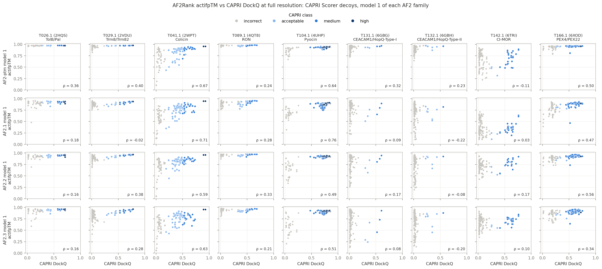
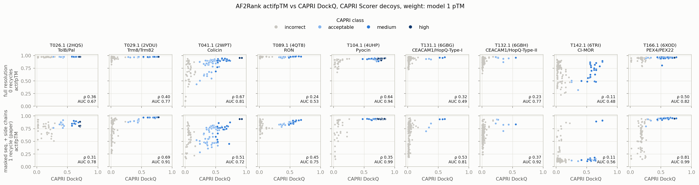

# CAPRI decoy benchmark

Can AF2Rank tell good docking models from bad ones? We scored the CAPRI Score_set decoys of 9 two-chain protein–protein targets with all 17 AlphaFold2 weights, in two settings, full resolution and masked (153 target × weight runs each), then compared each score with CAPRI's own DockQ and quality classes. Settings and scores are defined in the [main README](../../README.md#scores-and-settings).

**Result.**
- **Masked (the AF2Rank paper's setting), AlphaFold's interface confidence separates good from incorrect decoys.** actifpTM ranks a good decoy first in 69% of runs (random picking: 36%), with median AUC 0.83.
- **Combining the models of one AlphaFold version works best.** Averaging each decoy's rank over the AF2.2 or AF2-ptm models puts a good decoy first for 7 of 9 targets and within the top 5 for all 9.
- **At full resolution AlphaFold copies the decoys,** and the same scores are close to random (actifpTM top-1 44%).

**This is a best case.** Every target predates the AlphaFold2 training cutoff, so AlphaFold may have seen these complexes. CASP15 multimer models (post-cutoff) are the planned follow-up.

## Data

Decoys come from the CAPRI scoreset v2022 ([scoreset.org](https://scoreset.org); Lensink, Mauri, Brysbaert and Wodak), Scorer (S) model sets, i.e. the decoys submitted by the CAPRI scorer groups. Targets were chosen with the rules of our NMR and X-ray benchmarks:
- two-chain protein–protein complexes of natural proteins;
- no peptide partners, designed binders or nanobodies; one entry per complex;
- at least about 15 acceptable-or-better models;
- no biological non-protein molecules in the PDB entry. This excluded T025, T032, T040, T046, T047 and T105; crystallisation additives were tolerated.

| Target | PDB | Complex | Decoys | Acceptable or better |
| --- | --- | --- | --- | --- |
| T026.1 | 2HQS | TolB/Pal | 65 | 26 |
| T029.1 | 2VDU | Trm8/Trm82 | 135 | 27 |
| T041.1 | 2WPT | colicin E9 DNase/Im2 | 130 | 74 |
| T089.1 | 4QT8 | RON Sema-PSI-IPT1 domains | 110 | 46 |
| T104.1 | 4UHP | pyocin AP41 DNase/immunity | 170 | 139 |
| T131.1 | 6GBG | CEACAM1/HopQ type I | 185 | 6 |
| T132.1 | 6GBH | CEACAM1/HopQ type II | 189 | 9 |
| T142.1 | 6TRI | CI/MOR repressor–antirepressor | 166 | 45 |
| T166.1 | 6XOD | PEX4/PEX22 | 190 | 89 |

Decoys were trimmed to the residues resolved in the native, and 10 T029 decoys covering less than half of the receptor were dropped. 1,340 decoys pass the pipeline's strict cleaning: 77 high, 244 medium, 140 acceptable and 879 incorrect. "Good" below means CAPRI acceptable or better (34%); CAPRI classes and the other scores are defined in the [main README](../../README.md#scores-and-settings).

Eleven decoys (10 of T041, 1 of T131) have no interface in the input. All are CAPRI-incorrect, so the analysis gives them DockQ input→output 0 and the maximum PAE.

## Full resolution vs masked: which score separates good from bad decoys?

One run = one target scored with one weight (153 per setting). AUC: median over runs; top-1 and top-5: share of runs with a good decoy ranked first or within the first five; top 10: mean number of good decoys in the first ten. Composite = z(−PAE at input contacts) + z(actifpTM) + z(fnat input→output), with z-scores taken within each target and weight.

| Score | AUC, full → masked | Top-1, full → masked | Top-5, full → masked | Good in top 10, full → masked |
| --- | --- | --- | --- | --- |
| actifpTM | 0.67 → 0.83 | 44% → **69%** | 67% → 84% | 5.0 → **6.9** |
| PAE at input contacts | 0.75 → 0.84 | 43% → 67% | 59% → 80% | 4.9 → 6.3 |
| composite | 0.75 → **0.86** | 59% → **69%** | 73% → **86%** | 5.3 → 6.5 |
| ipTM | 0.63 → 0.82 | 39% → 61% | 57% → 79% | 4.2 → 6.2 |
| pLDDT × pTM × DockQ input→output (AF2Rank) | 0.62 → 0.81 | 54% → 67% | 65% → 82% | 4.3 → 6.1 |
| DockQ input→output | 0.60 → 0.78 | 48% → 48% | 63% → 77% | 4.0 → 5.3 |
| random picking | 0.50 | 36% | 74% | 3.6 |

Masking improves every score. Top-5 success says little on its own here: most targets have many good decoys, so five random picks include one in 74% of runs.

Scores computed at full resolution only: actifpTM × fnat input→output (AUC 0.71, the best top-1 at full resolution, 64%), pTM (0.68), min inter-chain PAE (0.67), LIS and ipSAE (0.64), pDockQ (0.54).

### Full resolution: AlphaFold copies the decoy

Median DockQ input→output by CAPRI class, full resolution → masked:

| CAPRI class | AF2-ptm | AF2.1 | AF2.2 | AF2.3 |
| --- | --- | --- | --- | --- |
| incorrect | 0.85 → 0.46 | 0.82 → **0.02** | 0.70 → 0.27 | 0.79 → 0.20 |
| acceptable | 0.86 → 0.58 | 0.87 → **0.13** | 0.72 → 0.44 | 0.81 → 0.40 |
| medium | 0.86 → 0.53 | 0.78 → 0.48 | 0.68 → 0.53 | 0.78 → 0.54 |
| high | 0.89 → 0.61 | 0.88 → 0.59 | 0.72 → 0.63 | 0.84 → 0.64 |

At full resolution DockQ input→output stays above 0.6 for most incorrect decoys: 96–97% with AF2-ptm and 74–89% with AF2.3 (all 879 incorrect decoys, including the 11 without an interface). Median ipTM barely differs between incorrect and good decoys. That is why ipTM, and the paper's "kept" term (DockQ or TM-score input→output), separate poorly at full resolution; the paper masked the sequence and side chains for exactly this reason. Masked, AlphaFold lets wrong interfaces drift away while good ones mostly stay. AF2.1 also pulls apart most acceptable decoys, as it does with native X-ray interfaces ([X-ray benchmark](../xray#scores-in-the-af2rank-papers-masked-setting)).

At full resolution the composite is the best score by AUC: AUC 0.75, top-1 59%, top-5 73%. Rank-averaged over all 17 weights it reaches AUC 0.78 and ranks a good decoy first for 6 of 9 targets (7 of 9 with the AF2.2 weights alone). What did not help: ipSAE, LIS or pDockQ in place of PAE at contacts; hard gates on DockQ or iRMSD input→output; and a logistic regression on all scores trained on the other targets (median AUC 0.71). T131 and T132 (CEACAM1/HopQ, CAPRI's two "difficult" targets, with 6 and 9 good decoys) and T142 (CI/MOR) defeat every score at full resolution.



**actifpTM against CAPRI DockQ at full resolution**, model 1 of each family; one point per decoy, coloured by CAPRI class. Most decoys sit at actifpTM 0.9–1.0 whatever their quality. The same plot with ipTM is [`figures/fullres_i_ptm_vs_dockq.png`](figures/fullres_i_ptm_vs_dockq.png). [`figures/fullres_ranking_summary.png`](figures/fullres_ranking_summary.png) has three heatmaps per score (ipTM, actifpTM, PAE at input contacts), one cell per target × weight: Spearman ρ with CAPRI DockQ, AUC, and good decoys in the top 10 with the random expectation in brackets.

## Masked: by AlphaFold version

| Version | actifpTM AUC | actifpTM top-1 | actifpTM top-5 | composite AUC | composite top-1 |
| --- | --- | --- | --- | --- | --- |
| AF2-ptm (2 models) | 0.71 → 0.85 | 39% → 67% | 61% → **94%** | 0.74 → 0.88 | 50% → 61% |
| AF2.1 multimer | 0.66 → 0.79 | 31% → 58% | 62% → 73% | 0.74 → 0.77 | 44% → 62% |
| AF2.2 multimer | 0.70 → **0.88** | 58% → **80%** | 76% → 93% | 0.77 → **0.90** | 67% → **78%** |
| AF2.3 multimer | 0.64 → 0.81 | 44% → 69% | 64% → 82% | 0.76 → 0.80 | 69% → 71% |

Values are full resolution → masked, per run (AF2-ptm: 18 runs; each multimer version: 45). Every version gains from masking. AF2.2 gains most; AF2.1 and AF2.3 gain less, mostly because the composite's "kept" term (fnat input→output) also drops for good decoys.

**One ranking per target.** Averaging each decoy's rank over a set of weights (targets out of 9; random picking: 3.2 first, 6.7 in the top 5):

| Weights | Score | Good decoy first, full → masked | In top 5, full → masked | Median AUC, full → masked |
| --- | --- | --- | --- | --- |
| AF2-ptm models 1–2 | composite | 5 → **8** | 7 → **9** | 0.74 → 0.89 |
| AF2-ptm models 1–2 | actifpTM | 4 → 7 | 6 → **9** | 0.75 → 0.82 |
| AF2.2 models 1–5 | actifpTM | 4 → 7 | 7 → **9** | 0.69 → 0.88 |
| AF2.2 models 1–5 | composite | 7 → 7 | 7 → 8 | 0.77 → **0.90** |
| AF2.3 models 1–5 | composite | 6 → 7 | 7 → 8 | 0.75 → 0.74 |
| AF2.1 models 1–5 | actifpTM | 3 → 5 | 5 → 6 | 0.63 → 0.76 |
| all 17 weights | actifpTM | 4 → 5 | 7 → 8 | 0.68 → 0.86 |
| all 17 weights | composite | 6 → 7 | 6 → **9** | 0.78 → 0.78 |

Pooling all 17 weights is worse than AF2-ptm or AF2.2 alone, because AF2.1 and AF2.3 add noise. The choice of version was made on these 9 targets and needs confirming on new ones (CASP15).

Per target (actifpTM, median AUC per version; [`results/masked_vs_fullres_per_target.csv`](results/masked_vs_fullres_per_target.csv)), masking raises the AUC on most targets. T104 was already near perfect (0.96–0.99). Exceptions:
- **T041** gets worse with every version (about 0.80–0.87 → 0.68–0.77). Many of its acceptable decoys (DockQ 0.3–0.5) lose confidence along with the incorrect ones, so masked AlphaFold is strict about partly right interfaces.
- **T026** drops with AF2.1 (0.66 → 0.34), where every decoy, good or not, ends at low confidence.
- **T131** stays weak with AF2.2 (0.37 → 0.52), while the other versions separate it (0.71–0.80).
- **T132** stays weak with AF2.1 (0.40 → 0.46).
- **T142** stays near random with AF2-ptm and AF2.1 (about 0.51); AF2.2 and AF2.3 reach 0.71–0.74.



**actifpTM against CAPRI DockQ, full resolution (top) and masked (bottom)**, AF2-ptm model 1, the paper's weight; one column per target, one point per decoy coloured by CAPRI class, with Spearman ρ and AUC in each panel. Masked, the incorrect decoys (grey) drop while the good ones stay confident. T131 and T132 become separable (AUC 0.81 and 0.92); with this weight AlphaFold loses confidence in almost every T142 decoy. The same plot for model 1 of the multimer versions: [AF2.1](figures/masked_vs_fullres_actifptm_model_1_multimer.png), [AF2.2](figures/masked_vs_fullres_actifptm_model_1_multimer_v2.png), [AF2.3](figures/masked_vs_fullres_actifptm_model_1_multimer_v3.png).

## Reproduce

From `benchmarks/capri`:

```bash
python scripts/analyze_scores.py      # single scores, pooled thresholds, logistic regression
python scripts/strategies.py          # composites, gates, consensus over weights and families
python scripts/plot_fullres.py        # full-resolution scatter plots and heatmaps
python scripts/masked_vs_fullres.py   # masked vs full resolution: summaries, consensus and scatter plots
```

The runs used Slurm scripts like those in [`cluster/marenostrum5`](../../cluster/marenostrum5): full resolution with `--strict-clean --no-mask-sequence --no-mask-sidechains --recycles 0`, masked with `--strict-clean --recycles 1`, and the 20-glycine linker for multimer weights.

## Files

| Path | Contents |
| --- | --- |
| `data/capri_targets.csv` | the 9 targets: PDB, chains, lengths, CAPRI difficulty, interaction type, description |
| `data/capri_decoys.csv` | the 1,340 decoys: scoreset model and source IDs, MD5, CAPRI DockQ, fnat, iRMS, LRMS and class |
| `results/scores_capri_fullres_all_weights.csv` | full resolution, one row per decoy × weight (22,780): pLDDT, pTM, ipTM, actifpTM, PAE, PAE at input contacts, DockQ / fnat / iRMSD input→output, ipSAE, LIS, min inter-chain PAE, pDockQ, CAPRI DockQ and class |
| `results/scores_capri_masked_all_weights.csv` | masked setting, same layout without ipSAE, LIS, min inter-chain PAE and pDockQ |
| `results/summary_by_score.csv`, `per_run_metrics.csv`, `pooled_by_score.csv`, `loto_logistic.csv` | output of `analyze_scores.py` |
| `results/strategies_*.csv` | output of `strategies.py` |
| `results/ranking_summary.csv` | per target × weight ranking metrics behind the heatmaps |
| `results/masked_vs_fullres_*.csv` | output of `masked_vs_fullres.py`: per-run summary, by family, consensus, per target |
| `figures/` | the figures above |
| `scripts/` | `common.py` (table loader) and the four analysis scripts |

The decoy structures are not included; they are available from [scoreset.org](https://scoreset.org). Please cite the CAPRI Score_set when using the CAPRI classes and DockQ values.
