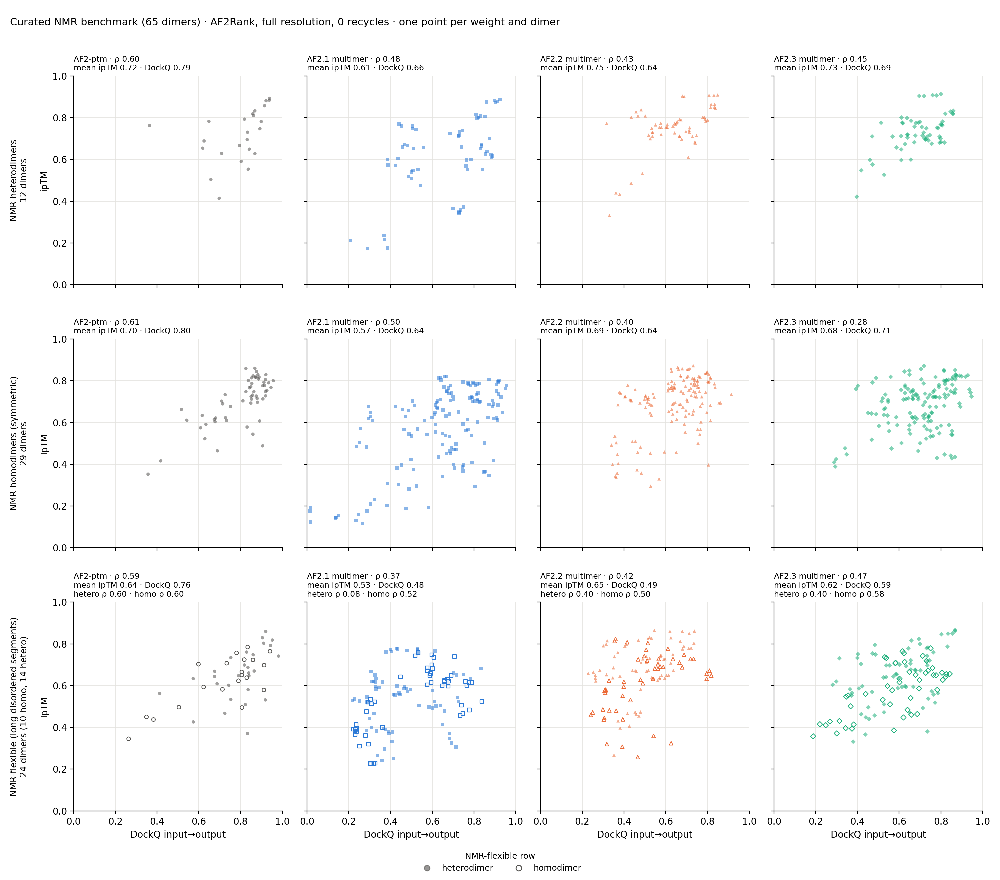
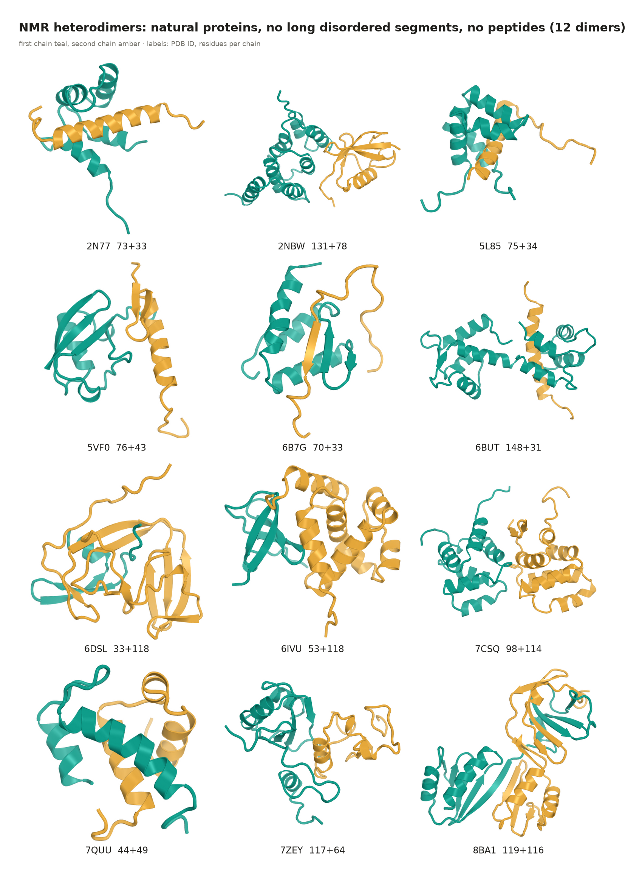
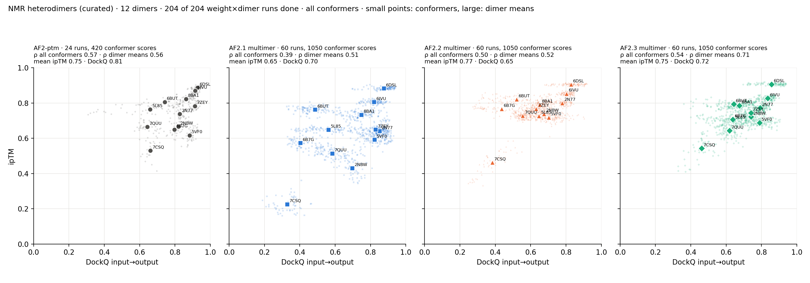

# Curated NMR dimer benchmark: one conformer per ensemble

AF2Rank scores for 65 protein dimers solved by solution NMR, each scored with all 17 template-capable AlphaFold2 weights. The set is a curated subset of the 99-dimer NMR benchmark of B. Savaş's PhD thesis (chapter 4), whose interfaces AlphaFold2 did not see in training. The curation notes are in [`CURATION.md`](CURATION.md).

**Conformers.** The main tables and figures use **model 1 (the first conformer) of each NMR ensemble**. Scores for **every deposited conformer** are included for NMR-hetero ([below](#all-conformers-nmr-hetero)); NMR-homo and NMR-flexible are not yet in this folder.

## How the dimers were scored

- **Inputs:** model 1 of each deposited ensemble, cleaned by the pipeline's strict cleaning. Sequences come from SEQRES, trimmed to the modelled span; the FASTA files are in [`data/fasta/`](data/fasta).
- **Settings:** full resolution (template sequence and side chains kept), 0 recycles, one iteration. This was the best-performing condition in the thesis benchmark (the thesis runs gave the chains as separate templates; these runs use the linker).
- **Weights:** AF2-ptm models 1–2 and AF2.1, AF2.2 and AF2.3 multimer models 1–5. For multimer weights, the two chains are joined by a 20-glycine linker that is masked in the template and removed before scoring (see the [report](../../docs/af2rank_all_weights.md)).
- **Scores:** `results/scores_model1_all_weights.csv` holds pLDDT, pTM, ipTM, actifpTM, DockQ input→output and interface RMSD input→output for each dimer and weight (1,105 rows). DockQ input→output compares the input model with AlphaFold's output. It measures how far AlphaFold moves the interface, not agreement with another experimental structure ([Scores and settings](../../README.md#scores-and-settings)).
- **Hardware:** MareNostrum 5, H100 GPUs, with the Slurm scripts in [`cluster/marenostrum5`](../../cluster/marenostrum5); those run the masked defaults, so for this setting add `--no-mask-sequence --no-mask-sidechains --recycles 0` to the `run-target` line.

## Sub-benchmarks

| Sub-benchmark | Dimers | What it contains | Structures |
| --- | --- | --- | --- |
| NMR-homo | 29 | symmetric homodimers without long disordered segments | [figure](figures/structures_homo.png) |
| NMR-hetero | 12 | heterodimers of natural proteins without long disordered segments | [figure](figures/structures_hetero.png) |
| NMR-flexible | 24 | dimers with long disordered segments (10 homo, 14 hetero) | [figure](figures/structures_flexible.png) |

The PDB IDs of each sub-benchmark are listed in `data/kept_homo.txt`, `data/kept_hetero.txt` and `data/kept_flexible.txt`. `data/targets.csv` has one row for each of the original 99 dimers, giving its status, sub-benchmark, exclusion reason and properties (interface size, chain-B spread across the ensemble, backbone RMSD, flags).



**ipTM against DockQ input→output** for model 1 of each dimer. Each point is one dimer scored with one weight. ρ is the Spearman correlation over all points in a panel. In the NMR-flexible row, homodimers are hollow and heterodimers filled.

**Means for each sub-benchmark** (ipTM / DockQ input→output):

| Weight set | NMR-homo | NMR-hetero | NMR-flexible |
| --- | --- | --- | --- |
| AF2-ptm | 0.70 / 0.80 | 0.72 / 0.79 | 0.64 / 0.76 |
| AF2.1 multimer | 0.57 / 0.64 | 0.61 / 0.66 | 0.53 / 0.48 |
| AF2.2 multimer | 0.69 / 0.64 | 0.75 / 0.64 | 0.65 / 0.49 |
| AF2.3 multimer | 0.68 / 0.71 | 0.73 / 0.69 | 0.62 / 0.59 |

With the multimer weights, DockQ input→output is about 0.1 lower for the NMR-flexible dimers than for the other two sets, while ipTM differs less. The heterodimer and flexible sets are small (12 and 24 dimers, five points per dimer and multimer weight set), so treat their correlations as rough estimates.



**NMR-hetero structures** (model 1; first chain teal, second amber). The homodimer and flexible sets are in [`figures/structures_homo.png`](figures/structures_homo.png) and [`figures/structures_flexible.png`](figures/structures_flexible.png).

## All conformers: NMR-hetero



**Every conformer of the 12 NMR heterodimers** (210 conformers × 17 weights; small points: one conformer and weight, large points: the dimer mean over conformers and weights of a set). ρ is the Spearman correlation between ipTM and DockQ input→output.

| Weight set | ρ, all conformers | ρ, dimer means | Mean ipTM / DockQ |
| --- | --- | --- | --- |
| AF2-ptm | 0.57 | 0.56 | 0.75 / 0.81 |
| AF2.1 multimer | 0.39 | 0.51 | 0.65 / 0.70 |
| AF2.2 multimer | 0.50 | 0.52 | 0.77 / 0.65 |
| AF2.3 multimer | 0.54 | 0.71 | 0.75 / 0.72 |

Averaged over each ensemble, AF2.3 ipTM follows DockQ input→output closely (ρ 0.71). Scores vary little between conformers of one dimer compared with the differences between dimers; 7CSQ is lowest with every weight set. Scores: `results/scores_hetero_all_conformers_all_weights.csv` (one row per conformer and weight); figure: `python scripts/plot_all_conformers.py results/scores_hetero_all_conformers_all_weights.csv "NMR-hetero" figures/iptm_vs_dockq_hetero_all_conformers.png`.

## Curation in brief

The thesis selected 99 NMR dimers released between March 2016 and December 2025. Each has an interface that AlphaFold2 could not have seen, no mutations, post-translational modifications or covalent interfaces, and secondary structure at the interface. From these, 34 were removed:

- **No published paper** (RCSB primary citation "To be published"): 7 dimers.
- **Not an experimentally determined complex:** HADDOCK docking or complexes assembled from earlier structures (7 dimers), and one complex built from lanthanide pseudocontact shifts only.
- **Lipid-modified peptide at the interface:** 7NQC.
- **Peptide partner** (a chain shorter than 30 residues): 16 dimers.
- **Not a natural protein pair:** a reconstructed ancestral complex of two intrinsically disordered proteins (6ES7) and a de novo designed heterodimer (6DMP).

[`CURATION.md`](CURATION.md) lists every exclusion with its reason, the kept IDs and the decision log.

## Files

| Path | Contents |
| --- | --- |
| `CURATION.md` | selection criteria, kept and excluded dimers, decision log |
| `data/targets.csv` | the original 99 dimers with status, sub-benchmark, reason and properties |
| `data/kept_*.txt` | PDB IDs per sub-benchmark |
| `data/fasta/` | trimmed FASTA files of the 65 kept dimers (model coordinates: model 1 of each PDB entry) |
| `results/scores_model1_all_weights.csv` | scores for 65 dimers × 17 weights (columns `pdb_id` and `iptm`; the other benchmarks use `target` and `i_ptm`) |
| `results/scores_hetero_all_conformers_all_weights.csv` | NMR-hetero, every conformer × 17 weights |
| `figures/` | the scatterplot and one page of structures per sub-benchmark |
| `scripts/` | `plot_subsets_grid.py` (scatterplot), `plot_all_conformers.py` (all-conformer plot), `render_nmr99.py` (PyMOL thumbnails), `make_a4_page.py` (structure pages) |

Redraw the scatterplot from this folder:

```bash
python scripts/plot_subsets_grid.py results/scores_model1_all_weights.csv data/targets.csv figures/iptm_vs_dockq_by_subbenchmark.png
```

The PDB archive data are [CC0](https://www.rcsb.org/pages/usage-policy). Per-target scores of the original 99 dimers under all 510 thesis conditions are at [busrasavas/AF2Rank-PPI](https://github.com/busrasavas/AF2Rank-PPI).
