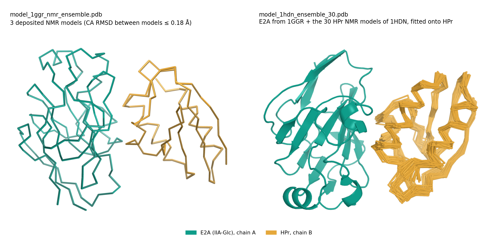
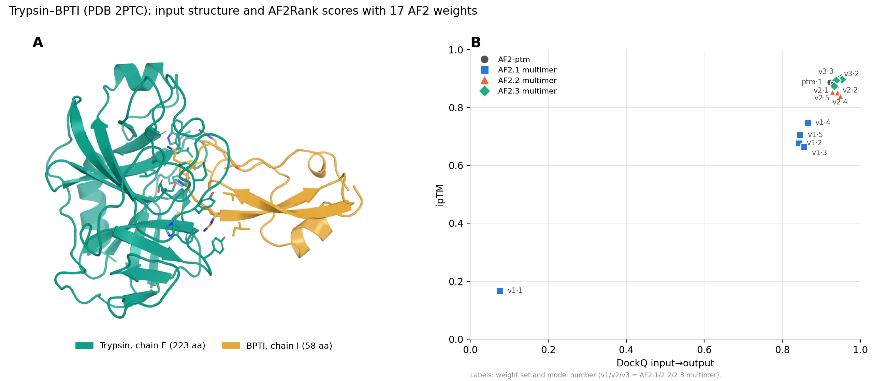
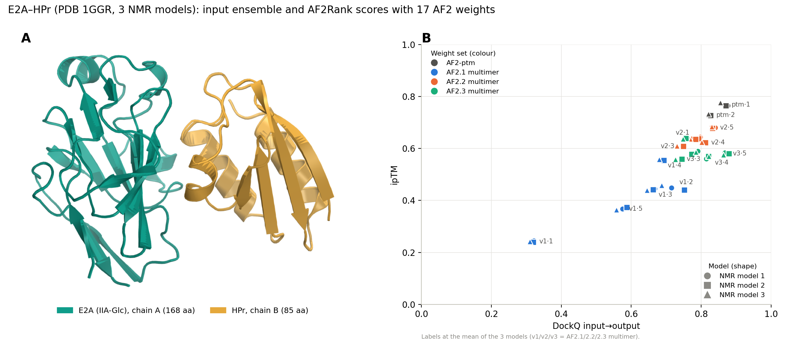

# AF2Rank with every template-capable AlphaFold2 weight: a Colab notebook and pipeline for rescoring protein dimers

**Colab notebook:** <https://colab.research.google.com/github/CSB-KaracaLab/af2rank-pipeline/blob/main/notebooks/colab_demo.ipynb>

## Motivation

AF2Rank asks AlphaFold2 whether it agrees with a given structure: the model is passed as a template with its sequence and side chains masked, AlphaFold2 runs on a single sequence, and confident, structure-preserving predictions mark models it recognises (Roney and Ovchinnikov, 2022). AF2Rank was introduced with the AF2-ptm weights (Jumper et al., 2021), but three AF2-multimer releases have appeared since (Evans et al., 2021), and each handles templates per chain. We wanted a single tool that rescores a dimer model with every weight that accepts templates, keeps the dimer intact as one template for multimer weights, and runs both in a browser and on a cluster.

## Implementation

The notebook and pipeline offer the 17 AlphaFold2 weights that accept templates (Table 1). AF2-ptm models 3–5 are left out because they were trained without templates.

**Table 1.** Template-capable weights and how the dimer is given to AlphaFold2.

| Weight set | DeepMind archive | Weights | Dimer given as |
| --- | --- | --- | --- |
| AF2-ptm | 2022-12-06 | model_1_ptm, model_2_ptm | two chains |
| AF2.1 multimer (v1) | 2021-10-27 | model_1–5_multimer | one chain: A + 20 Gly + B |
| AF2.2 multimer (v2) | 2022-03-02 | model_1–5_multimer_v2 | one chain: A + 20 Gly + B |
| AF2.3 multimer (v3) | 2022-12-06 | model_1–5_multimer_v3 | one chain: A + 20 Gly + B |

Each model is scored with each selected weight in five steps:

1. **Clean.** Chains are matched to the FASTA, non-protein atoms, waters and hydrogens are removed, and multi-model files (NMR or MD ensembles) are split into one model each.
2. **Link (multimer weights only).** The chains are joined into one chain with 20 glycines. Linker backbone atoms are placed on the line between the two chain ends and their template features are removed, so AlphaFold2 gets no template guidance there.
3. **Rescore.** ColabDesign runs AlphaFold2 in AF2Rank mode: single sequence, the model as template with its sequence and side chains masked, one recycle.
4. **Unlink and trim.** The output is split back into the original chains and numbering. The linker rows and columns are removed from the predicted aligned error (PAE) and distogram outputs before any score is computed.
5. **Score.** Mean pLDDT, pTM, ipTM (with the original chain labels) and actifpTM (Varga et al., 2025) are computed from the trimmed outputs; pTM uses the length without the linker. DockQ (Basu and Wallner, 2016) compares the cleaned input with the unlinked output, and contact PAE is the mean PAE over interface contacts.

On runs without a linker, these recomputed scores match ColabDesign's own values exactly, so scores are computed the same way with and without the linker.

## Input structures

Two classic test complexes were scored as deposited, each with all 17 weights; the cleaning step removed waters, ions, hydrogens and other non-protein atoms. Both are in [`examples/`](../examples).

- **Trypsin–BPTI, PDB 2PTC** (Marquart et al., 1983): a crystal structure of bovine trypsin (chain E, 223 residues) bound to the bovine pancreatic trypsin inhibitor (chain I, 58 residues), one model. [`examples/2ptc`](../examples/2ptc)
- **E2A–HPr, PDB 1GGR** (Wang et al., 2000): the 3 deposited NMR structures of the E. coli IIA-Glc (E2A, chain A, 168 residues with coordinates for 19–168) and HPr (chain B, 85 residues) phosphoryl-transfer complex, scored as one ensemble file. It is the reference complex of the HADDOCK E2A–HPr docking example (Dominguez et al., 2003). [`examples/e2a_hpr`](../examples/e2a_hpr)



**E2A–HPr input ensembles.** Left: the 3 NMR dimer models of 1GGR, which differ by at most 0.18 Å (CA RMSD). Right: a 30-model test ensemble, E2A from 1GGR with each of the 30 HPr NMR models of 1HDN fitted onto HPr. Both files are in `examples/e2a_hpr`.



**Figure 1.** Trypsin–BPTI (PDB 2PTC). (A) Input structure, trypsin in teal and BPTI in amber; interface side chains within 4.5 Å of the partner are shown as sticks. (B) ipTM against DockQ input→output for each of the 17 weights; colour and shape give the weight set, labels the model number (v1, v2, v3 = AF2.1, AF2.2, AF2.3 multimer).



**Figure 2.** E2A–HPr (PDB 1GGR). (A) The 3 NMR dimer models overlaid as cartoons, E2A in teal and HPr in amber; they differ by at most 0.18 Å (CA RMSD) and nearly coincide. The 30-model ensemble in `examples/e2a_hpr` shows a wider HPr spread. (B) ipTM against DockQ input→output for 3 models × 17 weights; colour gives the weight set and shape the NMR model, with labels at the mean of each weight's three models.

The plotted values are in `examples/2ptc/results/scores_all_weights.csv` and `examples/e2a_hpr/results/scores_all_weights.csv`; [`figures/scripts`](figures/scripts) redraws the figures (structures rendered with PyMOL).

## Usage

**In Colab** (free T4 GPU; connect a GPU runtime first):

1. Steps 1–3 set up the GPU, the pinned environment and the helpers, once per session.
2. Step 4 takes a FASTA file (one record per chain) and one or more PDB or mmCIF models; multi-model ensembles are allowed. Cancelling the uploads runs the bundled 1BRS example.
3. Step 5 selects the weight sets; each weight (about 373 MB) is downloaded once per session and reused.
4. Step 6 scores every model with every selected weight.
5. Steps 7–9 show the scores ranked by any metric, a scatterplot of any two scores, the structures (with an optional linker view), PAE maps, and a ZIP of all results.

New models need only steps 4 and 6 again; other weights need only steps 5 and 6.

**On a workstation or cluster**, one command scores a folder of models with one weight:

```bash
af2rank-pipeline run-target --target T --fasta T.fasta --models models/ --params params/ \
  --strict-clean --model-mode alphafold-multimer --multimer-version v3 --model-num 1 --out out/
```

Without `--model-mode alphafold-multimer` and `--multimer-version`, the command uses AF2-ptm (`--model-num` 1 or 2, default 2); the 20-glycine linker is the multimer default (`--multimer-linker`). With JAX 0.4.20 on H100 GPUs, set `XLA_FLAGS=--xla_gpu_force_compilation_parallelism=1`, which avoids an nvlink failure in XLA's parallel compilation. [`cluster/marenostrum5`](../cluster/marenostrum5) has the Slurm scripts used on MareNostrum 5.

## Run times

On one H100, scoring 3 models with one weight took a median of 47 s (Table 2), about 16 s per model and weight; on a laptop CPU, one model took about 4 min per weight.

**Table 2.** Run times for the two reported runs, all 17 weights each.

| Run | Hardware | Models × residues | Total | Per weight, median (range) | Per model and weight |
| --- | --- | --- | --- | --- | --- |
| Trypsin–BPTI (PDB 2PTC; Marquart et al., 1983) | Laptop CPU, macOS, Colab notebook cells | 1 × 281 | 71.3 min | 240 s (158–594 s) | 240 s |
| E2A–HPr (PDB 1GGR, NMR; Wang et al., 2000) | 1 × NVIDIA H100 64 GB, MareNostrum 5 | 3 × 253 | 16.1 min | 47 s (45–213 s) | 16 s |

Times per weight include cleaning, loading the weight, XLA compilation, scoring and DockQ; multimer runs also predict the 20 linker positions, which are then left out of the scores. Two outliers were not intrinsic: the last CPU weight (594 s) ran alongside a large download, and one H100 weight (AF2-ptm 2, 213 s) took longer once. Because compilation is paid once per weight, the cost per model falls as more models are scored together.

## Notes and limitations

- **DockQ input→output is not accuracy.** It measures how far AlphaFold2 moves the interface of the given model, not agreement with an experimental structure.
- **The linker is folded, not scored.** It is excluded from every score and its template is masked, but it is still part of the chain AlphaFold2 predicts and can affect the predicted structure.
- **Tested on dimers.** The notebook is written for dimers; the pipeline's linker joins consecutive chains of larger complexes too, but that has not been tested.
- **Pinned versions.** Scores come from ColabDesign 094e2cb with JAX 0.4.20; other versions may give slightly different numbers.

## Availability

- **Colab notebook:** <https://colab.research.google.com/github/CSB-KaracaLab/af2rank-pipeline/blob/main/notebooks/colab_demo.ipynb>
- **Source code:** <https://github.com/CSB-KaracaLab/af2rank-pipeline> (MIT licence), a fork of [sahinmtaylan/af2rank-pipeline](https://github.com/sahinmtaylan/af2rank-pipeline).
- **AlphaFold2 weights:** downloaded from DeepMind's archives by the notebook and checked against SHA-256 sums; the parameters are licensed under [CC BY 4.0](https://github.com/google-deepmind/alphafold#model-parameters).

## References

1. Basu S, Wallner B. DockQ: a quality measure for protein-protein docking models. *PLoS One* 11, e0161879 (2016).
2. Evans R, et al. Protein complex prediction with AlphaFold-Multimer. *bioRxiv* (2021). https://doi.org/10.1101/2021.10.04.463034
3. Jumper J, et al. Highly accurate protein structure prediction with AlphaFold. *Nature* 596, 583–589 (2021).
4. Marquart M, Walter J, Deisenhofer J, Bode W, Huber R. The geometry of the reactive site and of the peptide groups in trypsin, trypsinogen and its complexes with inhibitors. *Acta Crystallogr B* 39, 480–490 (1983).
5. Ovchinnikov S, et al. ColabDesign. https://github.com/sokrypton/ColabDesign (commit 094e2cb).
6. Roney JP, Ovchinnikov S. State-of-the-art estimation of protein model accuracy using AlphaFold. *Phys Rev Lett* 129, 238101 (2022). https://doi.org/10.1103/PhysRevLett.129.238101
7. Varga JK, Ovchinnikov S, Schueler-Furman O. actifpTM: a refined confidence metric of AlphaFold2 predictions involving flexible regions. *Bioinformatics* (2025).
8. Wang G, Louis JM, Sondej M, Seok YJ, Peterkofsky A, Clore GM. Solution structure of the phosphoryl transfer complex between the signal transducing proteins HPr and IIA-glucose of the Escherichia coli phosphoenolpyruvate:sugar phosphotransferase system. *EMBO J* 19, 5635–5649 (2000).
9. Dominguez C, Boelens R, Bonvin AMJJ. HADDOCK: a protein-protein docking approach based on biochemical or biophysical information. *J Am Chem Soc* 125, 1731–1737 (2003).
