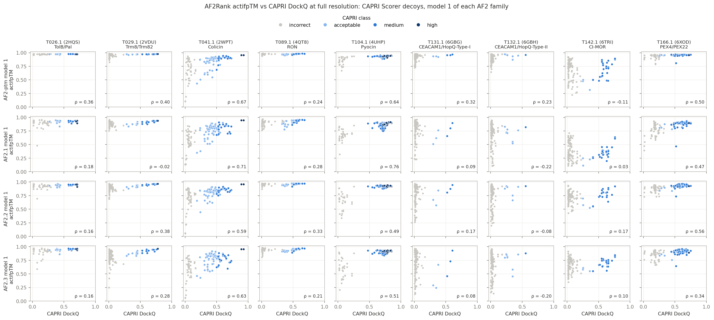
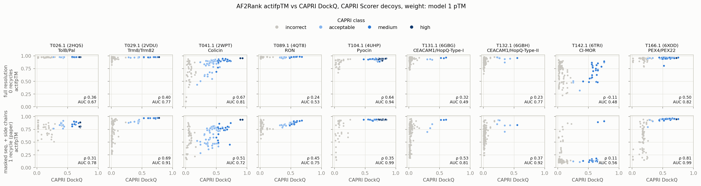

# CAPRI decoy benchmark

Can AF2Rank tell good docking models from bad ones? We scored the CAPRI Score_set decoys of 9 two-chain protein–protein targets with all 17 AlphaFold2 weights, then compared each score with CAPRI's own DockQ and quality classes.

**This is a best case.** Every target predates the AlphaFold2 training cutoff, so AlphaFold may have seen these complexes. CASP15 multimer models (post-cutoff) are the planned follow-up.

**Status:**
- **Full resolution** (sequence and side chains kept, 0 recycles): complete, 9 targets × 17 weights = 153 runs.
- **Masked** (the AF2Rank paper's setting: sequence and side chains masked, 1 recycle): a pilot with AF2-ptm models 1–2 and AF2.2 multimer models 1–5 is running. The table holds the runs finished so far (35 of 63) and will be updated.

## Data

Decoys come from the CAPRI scoreset v2022 ([scoreset.org](https://scoreset.org); Lensink, Mauri, Brysbaert and Wodak), Scorer (S) model sets. Targets were chosen with the rules of our NMR and X-ray benchmarks:
- two-chain protein–protein complexes of natural proteins;
- no peptide partners, designed binders or nanobodies; one entry per complex;
- at least about 15 acceptable-or-better models;
- no biological non-protein molecules in the PDB entry. This excluded T025, T032, T040, T046, T047 and T105; crystallisation additives were tolerated.

| Target | PDB | Complex | Decoys | Acceptable or better |
| --- | --- | --- | --- | --- |
| T026.1 | 2HQS | TolB/Pal | 65 | 26 |
| T029.1 | 2VDU | Trm8/Trm82 | 135 | 27 |
| T041.1 | 2WPT | colicin E9 DNase/Im2 | 130 | 74 |
| T089.1 | 4QT8 | RON Sema-PSI-IPT1 domains | 110 | 46 |
| T104.1 | 4UHP | pyocin AP41 DNase/immunity | 170 | 139 |
| T131.1 | 6GBG | CEACAM1/HopQ type I | 185 | 6 |
| T132.1 | 6GBH | CEACAM1/HopQ type II | 189 | 9 |
| T142.1 | 6TRI | CI/MOR repressor–antirepressor | 166 | 45 |
| T166.1 | 6XOD | PEX4/PEX22 | 190 | 89 |

Decoys were trimmed to the residues resolved in the native, and 10 T029 decoys covering less than half of the receptor were dropped. 1,340 decoys pass the pipeline's strict cleaning: 77 high, 244 medium, 140 acceptable and 879 incorrect. "Good" below means CAPRI acceptable or better (34%).

Eleven decoys (10 of T041, 1 of T131) have no interface in the input. All are CAPRI-incorrect, so the analysis gives them DockQ input→output 0 and the maximum PAE.

## Full resolution: which score separates good from bad decoys?

Median over the 153 runs (one run = one target × one weight); top-1 = how often the best-ranked decoy is good.

| Score | Median AUC | Top-1 |
| --- | --- | --- |
| PAE at the decoy's own input contacts | **0.75** | 0.42 |
| actifpTM × fnat input→output | 0.71 | **0.64** |
| pTM | 0.68 | 0.37 |
| actifpTM | 0.67 | 0.44 |
| min inter-chain PAE | 0.67 | 0.37 |
| LIS | 0.64 | 0.31 |
| ipSAE | 0.64 | 0.32 |
| ipTM | 0.63 | 0.39 |
| pLDDT × pTM × DockQ input→output (AF2Rank) | 0.62 | 0.54 |
| DockQ input→output | 0.60 | 0.48 |
| pDockQ | 0.54 | 0.18 |

**At full resolution AlphaFold copies the decoy.** DockQ input→output stays above 0.6 for most incorrect decoys (99% with the AF2-ptm weights, 74–91% with AF2.3), and median ipTM barely differs between incorrect and good decoys. That is why ipTM, and the paper's "kept" term (DockQ or TM-score input→output), separate poorly here. The paper masked the sequence and side chains for exactly this reason.

**The best combination is "confident and kept":** z(−PAE at input contacts) + z(actifpTM) + z(fnat input→output), with z-scores taken within each target and weight.
- Per run: AUC 0.75, top-1 good in 59% of runs, top-5 in 73%.
- Rank-averaged over all 17 weights: AUC 0.78, and a good decoy ranked first for 6 of 9 targets.
- AF2.2 multimer weights only: first for 7 of 9 targets. That choice was made after seeing these targets, so it needs confirming.

What did not help: ipSAE, LIS or pDockQ in place of PAE at contacts; hard gates on DockQ or iRMSD input→output; and a logistic regression on all scores trained on the other targets (median AUC 0.69).

T131 and T132 (CEACAM1/HopQ, the two "difficult" targets, with 6 and 9 good decoys) and T142 (CI/MOR) defeat every score at full resolution.



**actifpTM against CAPRI DockQ at full resolution**, model 1 of each family. Most decoys sit at actifpTM 0.9–1.0 whatever their quality. The same plot with ipTM is [`figures/fullres_i_ptm_vs_dockq.png`](figures/fullres_i_ptm_vs_dockq.png). Spearman, AUC and top-10 hits for every target × weight are in [`figures/fullres_ranking_summary.png`](figures/fullres_ranking_summary.png).

## Masked pilot (interim, 35 of 63 runs)

The [X-ray benchmark](../xray_benchmark#scores-in-the-af2rank-papers-masked-setting) showed that native interfaces stay confident and in place in the paper's masked setting, except with AF2.1. On the CAPRI decoys, masking lets wrong interfaces drift away.

Median DockQ input→output by CAPRI class, on the runs finished in both settings:

| CAPRI class | full resolution | masked |
| --- | --- | --- |
| incorrect | 0.79 | **0.36** |
| acceptable | 0.77 | 0.50 |
| medium | 0.75 | 0.54 |
| high | 0.77 | 0.63 |

Per-run medians on the same 35 runs:

| Score | AUC full → masked | Top-1 full → masked | Good in top 10 (random 3.9) |
| --- | --- | --- | --- |
| actifpTM | 0.77 → **0.87** | 54% → **74%** | 5.7 → **7.9** |
| PAE at input contacts | 0.78 → 0.87 | 46% → 74% | 5.2 → 7.1 |
| composite (PAE + actifpTM + fnat) | 0.75 → 0.88 | 63% → 71% | 5.4 → 7.4 |
| ipTM | 0.72 → 0.85 | 51% → 66% | 4.9 → 6.7 |
| pLDDT × pTM × DockQ input→output (AF2Rank) | 0.66 → 0.83 | 66% → 83% | 4.5 → 6.7 |
| DockQ input→output | 0.63 → 0.82 | 54% → 40% | 3.6 → 5.8 |



**actifpTM against CAPRI DockQ, full resolution (top) and masked (bottom)**, AF2-ptm model 1, the paper's weight. Masked, the incorrect decoys (grey) drop while the good ones stay confident. T131 and T132 become separable (AUC 0.81 and 0.92). T142 does not: with this weight AlphaFold loses confidence in almost every T142 decoy. AF2.2 multimer model 1 is in [`figures/masked_vs_fullres_actifptm_model_1_multimer_v2.png`](figures/masked_vs_fullres_actifptm_model_1_multimer_v2.png).

## Reproduce

From `examples/capri_benchmark`:

```bash
python scripts/analyze_scores.py      # single scores, pooled thresholds, logistic regression
python scripts/strategies.py          # composites, gates, consensus over weights and families
python scripts/plot_fullres.py        # full-resolution scatter plots and heatmaps
python scripts/masked_vs_fullres.py   # masked pilot vs full resolution: summary and scatter plots
```

The runs used Slurm scripts like those in [`../marenostrum5`](../marenostrum5): full resolution with `--strict-clean --no-mask-sequence --no-mask-sidechains --recycles 0`, masked with `--strict-clean --recycles 1`, and the 20-glycine linker for multimer weights.

## Files

| Path | Contents |
| --- | --- |
| `capri_targets.csv` | the 9 targets: PDB, chains, lengths, CAPRI difficulty, interaction type, description |
| `capri_decoys.csv` | the 1,340 decoys: scoreset model and source IDs, MD5, CAPRI DockQ, fnat, iRMS, LRMS and class |
| `results/scores_capri_fullres_all_weights.csv` | full resolution, one row per decoy × weight (22,780): pLDDT, pTM, ipTM, actifpTM, PAE, PAE at input contacts, DockQ / fnat / iRMSD input→output, ipSAE, LIS, min inter-chain PAE, pDockQ, CAPRI DockQ and class |
| `results/scores_capri_masked_pilot.csv` | masked pilot, same layout without the interface PAE scores (runs finished so far) |
| `results/summary_by_score.csv`, `per_run_metrics.csv`, `pooled_by_score.csv`, `loto_logistic.csv` | output of `analyze_scores.py` |
| `results/strategies_*.csv` | output of `strategies.py` |
| `results/ranking_summary.csv` | per target × weight ranking metrics behind the heatmaps |
| `results/masked_vs_fullres_summary.csv` | output of `masked_vs_fullres.py` |
| `figures/` | the figures above |
| `scripts/` | `common.py` (table loader) and the four analysis scripts |

The decoy structures are not included; they are available from [scoreset.org](https://scoreset.org). Please cite the CAPRI Score_set when using the CAPRI classes and DockQ values.
