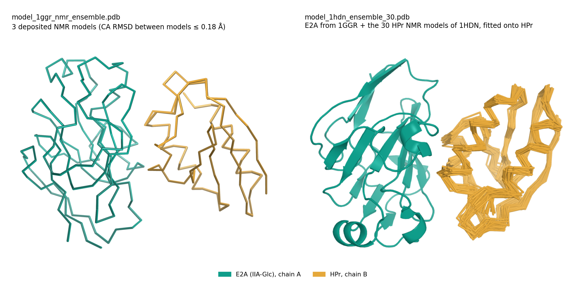

# E2A–HPr ensemble example (PDB 1GGR, 1HDN)

E2A (IIA-Glc) and HPr form the phosphoryl-transfer complex used in the HADDOCK E2A–HPr docking example. Both model files test ensemble input: every model in a multi-model PDB is cleaned and scored on its own.



The three 1GGR models differ by at most 0.18 Å (CA RMSD), so they nearly coincide; the 1HDN-based ensemble shows the spread of the HPr NMR models at the same interface.

| File | What it is |
|---|---|
| `target.fasta` | SEQRES sequences from 1GGR: chain A = E2A (168 residues), chain B = HPr (85 residues). |
| `model_1ggr_nmr_ensemble.pdb` | [PDB 1GGR](https://doi.org/10.2210/pdb1GGR/pdb) as deposited (Wang et al., 2000): the 3 regularized NMR structures of the complex. It includes hydrogens and a placeholder phosphite group at the origin, both removed by cleaning; E2A residues 1–18 have no coordinates. |
| `model_1hdn_ensemble_30.pdb` | A 30-model ensemble built for testing: E2A from 1GGR model 1, paired with each of the 30 HPr NMR models of [PDB 1HDN](https://doi.org/10.2210/pdb1HDN/pdb) (the HPr ensemble of the HADDOCK example), each fitted by CA atoms onto HPr in 1GGR (RMSD 0.97–1.56 Å). Heavy atoms only, HPr numbered 301–385 as in 1GGR. Interface side chains were not refined, so some models have close interchain contacts (median 5 heavy-atom pairs below 2.5 Å, at most 38). |
| `results/scores_all_weights.csv` | Scores for the 3 models of `model_1ggr_nmr_ensemble.pdb` with all 17 template-capable AF2 weights, from one H100 on MareNostrum 5 (16 min; `examples/marenostrum5`). |

```bash
af2rank-pipeline run-target --target e2a_hpr --fasta examples/e2a_hpr/target.fasta \
  --models examples/e2a_hpr/model_1ggr_nmr_ensemble.pdb --params params --strict-clean --out runs/e2a_hpr
```

Both model files pass the pipeline's strict cleaning (3 and 30 models). Figure 2 of the [report](../../docs/af2rank_all_weights.md) plots the 1GGR scores. The PDB archive data are [CC0](https://www.rcsb.org/pages/usage-policy).
