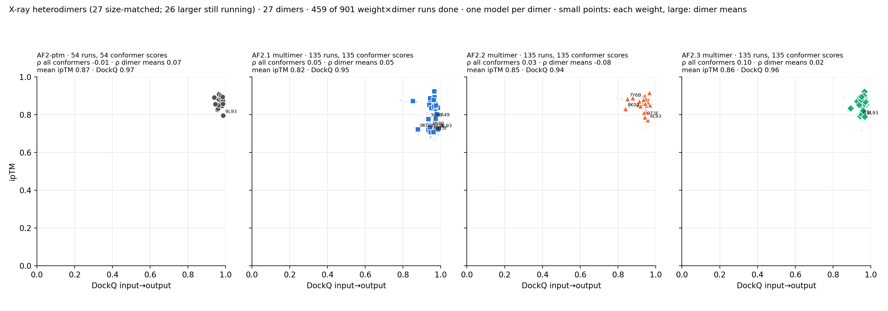

# Unseen X-ray dimer benchmark

X-ray protein dimers whose interfaces no AlphaFold2 version could have seen in training, curated as a control for the [NMR dimer benchmark](../nmr_benchmark). The crystal structures pass the same novelty test and the same quality rules as the curated NMR set.

- **X-ray-hetero:** 53 heterodimers. 27 are matched in size to the NMR heterodimers; 26 are larger natural complexes, since X-ray can determine larger complexes than NMR.
- **X-ray-homo:** 39 homodimers, matched in size to the NMR homodimers.

The full criteria, filtering counts and decision log are in [`CURATION.md`](CURATION.md).

**Status:** AF2Rank scores (17 weights, full resolution, 0 recycles, 20-glycine linker for multimer weights) are complete for the 27 size-matched heterodimers ([below](#scores-x-ray-hetero)); the 26 larger heterodimers are running, and X-ray-homo has not been scored yet.

## Curation logic

1. **Unseen by every AlphaFold2 version.** Released after 30 September 2021, the PDB cutoff of AF2-multimer v3. Novelty is judged per protein, by UniProt accession plus 100% sequence cluster:
   - homodimers: the protein had no earlier structure;
   - heterodimers: at least one partner had no earlier structure, or both had earlier structures but never together in one entry.

   Earlier structures of any method (X-ray, NMR, cryo-EM) count.
2. **Same quality rules as the curated NMR set:**
   - published (the RCSB primary citation is a paper, not "To be published");
   - no engineered mutations, modified residues, glycans or covalent cofactors, and no covalent link between the chains;
   - no peptides: every chain has at least 30 modelled residues;
   - natural proteins only: no synthetic constructs, designed binders or nanobodies.
3. **Clean two-chain assemblies.** X-ray at 2.5 Å or better. Biological assembly 1 is exactly two protein chains with an interface reported by RCSB, and no nucleic acid.
4. **Non-redundant.** One entry per 30%-identity cluster (homodimers) or cluster pair (heterodimers). Heterodimers are also limited to one entry per cluster of the longer chain.
5. **Size.** Matched to the curated NMR homo- and heterodimers by optimal one-to-one matching on log total length. Larger heterodimers that pass every other rule are added without matching.

| Step | Entries |
| --- | --- |
| Search: X-ray, ≤ 2.5 Å, released after 2021-09-30, two-chain protein assembly | 13,278 |
| No mutation, modification or covalent link between the chains | 7,963 |
| Chains ≥ 30 residues, interface reported, two distinct proteins (heterodimers) | 6,537 |
| Novel across all methods | 3,050 |
| Published | 2,166 |
| Non-redundant | 907 homo + 214 hetero |
| Natural proteins | 817 homo + 121 hetero |
| Selected | 39 homo + 53 hetero (8SJJ, a metastable coiled coil, later removed) |

## Scores: X-ray-hetero

**The 27 size-matched heterodimers** (one model each; small points: one weight, large points: the dimer mean over the weights of a set).

| Weight set | Mean ipTM | Mean DockQ input→output |
| --- | --- | --- |
| AF2-ptm | 0.87 | 0.97 |
| AF2.1 multimer | 0.82 | 0.95 |
| AF2.2 multimer | 0.85 | 0.94 |
| AF2.3 multimer | 0.86 | 0.96 |

AlphaFold keeps every crystal interface (DockQ input→output 0.94–0.97 on average) with high ipTM, so ipTM and DockQ barely correlate here (ρ near 0), unlike the NMR heterodimers. At full resolution the template keeps its sequence and side chains, so well-packed crystal interfaces may largely be reproduced; the NMR–X-ray difference reflects structure quality as well as interface recognition. Scores: `results/scores_xray_hetero_all_weights.csv`; figure: `scripts/plot_scores.py`.

## Structures

**X-ray-hetero** (biological assembly 1; first chain teal, second amber). X-ray-homo is in [`figures/structures_homo.png`](figures/structures_homo.png).

## Comparison with Genz et al. 2025

The heterodimer benchmark of Genz et al. (2025) has 262 heterodimers released after the AlphaFold2 cutoff ([doi:10.1002/pro.70327](https://doi.org/10.1002/pro.70327)). Its selection does not require interface novelty. [`genz2025_overlap.csv`](genz2025_overlap.csv) traces each of its entries through our filters:
- 117 are outside our search (most at 2.5–3.0 Å resolution);
- 77 fail our quality filters;
- 19 involve proteins or pairs seen before the cutoff;
- 8 have no paper.

26 of the larger natural complexes in X-ray-hetero come from this overlap.

## Files

| Path | Contents |
| --- | --- |
| `CURATION.md` | criteria, funnel, size match, decision log, open points |
| `xray_hetero.csv`, `xray_homo.csv` | one row per dimer: chains, entities, UniProt, residues, resolution, release date, novelty reason, 30%/100% clusters, interface area, citation; `source` gives the size-matched or added group |
| `kept_xray_hetero.txt`, `kept_xray_homo.txt` | PDB IDs per set |
| `fasta_hetero/` | trimmed FASTA files of the 53 heterodimers (coordinates: biological assembly 1 of each PDB entry, chains as in the CSV) |
| `interface_ss_hetero.csv` | interface residues and their helix/strand fraction per chain (8PFC chain A: loops only) |
| `genz2025_overlap.csv` | where each Genz et al. 2025 heterodimer leaves our selection |
| `funnel.csv` | counts after each selection step |
| `results/scores_xray_hetero_all_weights.csv` | AF2Rank scores, one row per heterodimer and weight (27 size-matched so far) |
| `scripts/` | `step1_fetch.py` and `step2_select.py` (RCSB search and selection), `rcsb_util.py`, and `prep/` (input building, strict-cleaning check, interface secondary structure) |

The selection uses the public RCSB APIs (metadata only) and reflects the PDB on 2026-11-21. The PDB archive data are [CC0](https://www.rcsb.org/pages/usage-policy).
